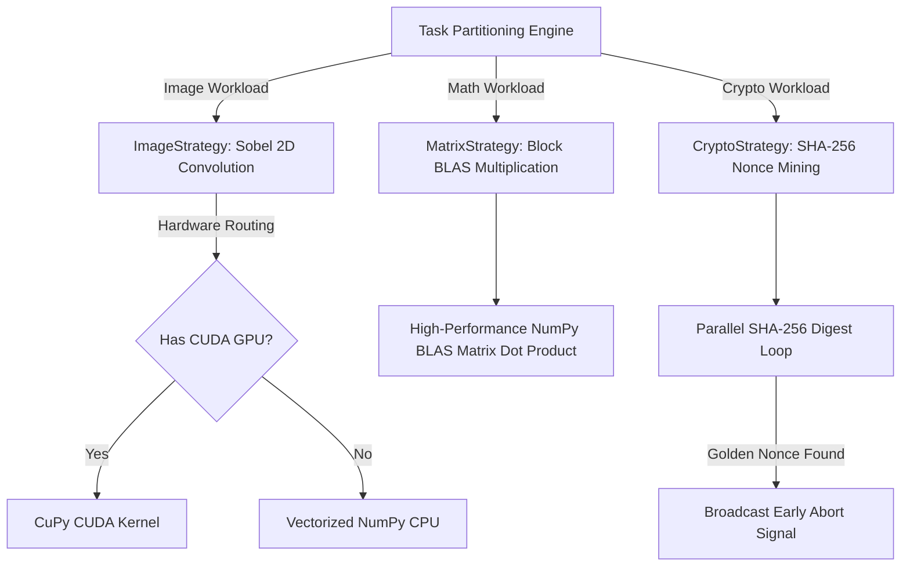

# DaeMon: Technical Research & Gap Analysis Document

> **Document Type:** Research & Domain Deep-Dive (`RESEARCH.md`)  
> **Project:** DaeMon — Frictionless, Containerized Distributed Compute Grid for Volunteer Resource Aggregation  
> **Target Scope:** 6-Phase Final Roadmap to Capstone Project Defense  
> **Academic Context:** 4th-Year Engineering Project, Department of Artificial Intelligence & Data Science, MET BKC Institute of Engineering  

---

## 1. Executive Summary & Objective

The objective of this research document is to establish a rigorous, production-grade technical foundation for completing the **DaeMon Distributed Compute Grid**. While the foundational skeleton (FastAPI orchestrator, basic RabbitMQ/MinIO integration, initial Next.js dashboard, and recent CuPy GPU smoke-testing) is functional, critical architectural gaps remain between the current prototype and the academic design contracts specified in:
1. The **Project Abstract** (`DaeMon_Project_Abstract.docx`)
2. The **Master Implementation Plan** (`IMPLEMENTATION_PLAN.md`)
3. The **IEEE Survey Paper** (`survey paper/DaeMon_Survey_Paper.docx`)
4. The active **Defect Scratchpad** (`problems.txt`)

This document performs an exhaustive root-cause analysis of current bugs (including the Docker container communication failure noted in `problems.txt`), analyzes the algorithms required for the polymorphic task engines (Matrix Multiplication and Cryptographic PoW Search), formalizes the sliding-window Redis TTL heartbeat model, and designs the end-to-end result aggregation and speedup validation methodologies.

---

## 2. Current State vs. Desired State Audit

| Subsystem | Current Codebase State | Desired Production State | Technical Gap |
| :--- | :--- | :--- | :--- |
| **Container Networking** | `start_grid.bat` boots Uvicorn on default host (`127.0.0.1:8000`). Docker containers querying `host.docker.internal:8000` receive connection refused. | Workers inside Docker communicate smoothly with host FastAPI Orchestrator, RabbitMQ, and MinIO. | Missing `--host 0.0.0.0` binding in orchestrator startup; missing host gateway flags. |
| **Distributed Math Strategy** | `worker/strategies/dummy_math.py` executes `time.sleep(1.5)` simulation. | Real distributed Block Matrix Multiplication ($C = A \times B$) via NumPy BLAS sub-block dot products ($C_{ij} = \sum A_{im} \cdot B_{mj}$). | No actual numerical matrix computation engine in worker strategy. |
| **Cryptographic Search Strategy** | Dataset generator exists (`generate_crypto_payload.py`), but worker has no crypto execution strategy. | Real parallel SHA-256 pre-image and nonce mining across partitioned keyspace ranges with early abort broadcast signal. | Missing `worker/strategies/crypto_strategy.py` and AMQP abort channel. |
| **Result Aggregator** | `orchestrator/core/aggregator.py` simulates stitching with `await asyncio.sleep(1)` and static mock URL. | Real binary stitching: concatenates image strips, reassembles matrix blocks, and packages unified downloadable ZIP. | Mock aggregation logic in backend; no true payload reassembly. |
| **Fault Tolerance & Churn** | Workers do not emit recurring heartbeats. Redis TTL lease key mechanism is idle. Stalled tasks are not auto-requeued. | Active sliding-window Redis TTL leases (5s heartbeat / 15s expiration); orchestrator reaper evicts dead workers and re-queues tasks in <15s. | Missing background heartbeat thread in worker; missing reaper loop in orchestrator. |
| **Telemetry & Observability** | Dashboard polls `/jobs` every 3s and `/events` every 2s via HTTP requests. | Full-duplex WebSocket streaming (`/ws/jobs/{id}`) providing sub-second event logs and live hardware gauges (CPU, GPU, RAM). | HTTP polling latency; no persistent WebSocket connection manager. |
| **Empirical Evaluation** | Only single-node smoke tests conducted. | Empirical speedup curves ($S(P)$) across 1, 2, and 4 nodes matching Amdahl's Law derivation. | Missing automated multi-worker benchmark harness. |

---

## 3. Deep-Dive: Phase 1 — Container Connectivity & Docker Networking

### 3.1 Root Cause Analysis of Problem #3
In `problems.txt`, the following defect is recorded:
> *"the container are not doing the tasks, if they do nothing appears on app (orchestrator and worker terminal)"*

An inspection of `start_grid.bat` line 11 reveals:
```bat
start "DaeMon Orchestrator" cmd /k "cd orchestrator && .\venv\Scripts\python.exe -m uvicorn main:app --reload --port 8000"
```
When Uvicorn runs without an explicit `--host` parameter, **it binds exclusively to `127.0.0.1` (the loopback interface)**.

In Docker Desktop for Windows (WSL2 backend), `host.docker.internal` resolves to the virtual bridge interface connecting the container network to the host (typically `192.168.65.2` or host gateway). When the Python process inside the container sends an HTTP `POST` request to `http://host.docker.internal:8000/api/v1/workers/register`:
1. The packet arrives at the Windows host on the virtual network adapter.
2. The Windows OS inspects the destination port `8000`.
3. Because Uvicorn is bound strictly to `127.0.0.1` (and NOT `0.0.0.0`), the kernel immediately drops/rejects the connection (`ECONNREFUSED`).
4. The worker's registration fails silently or times out, preventing task consumption and halting event emission to the dashboard.

### 3.2 Solution Architecture
To guarantee 100% reliable bidirectional networking between containerized volunteer daemons and the host orchestrator:
1. **Orchestrator Host Binding:** Reconfigure Uvicorn to listen on `0.0.0.0`:
   ```bash
   uvicorn main:app --reload --host 0.0.0.0 --port 8000
   ```
2. **Container Host-Gateway Routing:** Ensure that `docker run` invocations pass the `--add-host=host.docker.internal:host-gateway` flag for compatibility across Windows, Linux, and macOS Docker engines.
3. **MinIO and RabbitMQ Verification:** `docker-compose.yml` already maps `5672:5672` and `9090:9000` to `0.0.0.0`, ensuring external/container reachability.

---

## 4. Deep-Dive: Phase 2 — Polymorphic Workload Implementations

The DaeMon framework is designed as a **polymorphic compute grid**, capable of executing heterogeneous workload domains through a pluggable Strategy pattern.



### 4.1 Workload 1: Image Processing (Spatial Convolution with Overlap)
- **Mathematical Model:** 2D spatial convolution with orthogonal Sobel gradient kernels:
  $$G_x = \begin{bmatrix} -1 & 0 & 1 \\ -2 & 0 & 2 \\ -1 & 0 & 1 \end{bmatrix}, \quad G_y = \begin{bmatrix} -1 & -2 & -1 \\ 0 & 0 & 0 \\ 1 & 2 & 1 \end{bmatrix}, \quad |G| = \sqrt{G_x^2 + G_y^2}$$
- **Current Status:** CuPy CUDA acceleration and NumPy CPU fallback are functional in `worker/strategies/image_processing.py`.
- **Remaining Enhancement:** When splitting large single images into horizontal stripes, a 3x3 convolution kernel produces 1-pixel boundary black lines. Slicing must include a **1-pixel boundary overlap padding margin** ($y_{\text{start}}-1$ to $y_{\text{end}}+1$), which the stitcher cleanly crops before image reassembly.

### 4.2 Workload 2: Scientific Computing (Block Matrix Multiplication)
- **Mathematical Model:** Multiplying two large square matrices $A, B \in \mathbb{R}^{N \times N}$ to produce $C = A \times B$ has algorithmic complexity $\mathcal{O}(N^3)$.
- **Domain Decomposition:** Matrices $A$ and $B$ are partitioned into $k \times k$ sub-blocks of dimension $(N/k) \times (N/k)$. Each micro-task manifest $T_{ij}$ computes one block of the product:
  $$C_{ij} = \sum_{m=1}^k A_{im} \cdot B_{mj}$$
- **Data Flow & Execution:**
  1. Input JSON: `matrix_chunk_i.json` contains matrix row slices $A_{im}$ and column block $B_{mj}$.
  2. Computation: Worker loads matrices into float64 NumPy arrays, executes `np.matmul(A_slice, B_slice)`.
  3. Output Artifact: Sub-matrix $C_{ij}$ is dumped to JSON and uploaded to MinIO:
     `minio://daemon-jobs/{job_id}/results/{task_id}_matrix_block_{i}_{j}.json`.

### 4.3 Workload 3: Cryptographic Search (SHA-256 Proof-of-Work with Early Abort)
- **Mathematical Model:** Finding an integer nonce $n \in [0, 2^{32}-1]$ such that:
  $$\text{SHA256}(\text{SHA256}(\text{BlockHeader} \parallel n)) < \text{Target Difficulty } D$$
  (i.e., the hexadecimal digest begins with $d$ leading zeros, e.g., `"0000"`).
- **Domain Decomposition:** The $2^{32}$ integer search space is partitioned into $N$ non-overlapping slices:
  $$\text{Slice } j = \left[ j \cdot \frac{2^{32}}{N}, \; (j+1) \cdot \frac{2^{32}}{N} - 1 \right]$$
- **Early-Termination Signal:** Unlike embarrassingly parallel batch jobs where every task must complete, cryptographic search finishes the instant *any* worker discovers the golden nonce.
  1. Winning worker pings orchestrator: `POST /api/v1/jobs/{job_id}/nonce_found` with `{nonce, hash, worker_id}`.
  2. Orchestrator broadcasts an `ABORT` message over RabbitMQ topic exchange to all active workers on that pool.
  3. Remaining workers terminate their execution loops immediately, releasing CPU/GPU cycles.

---

## 5. Deep-Dive: Phase 3 — Result Aggregation & Output Stitching

In the decoupled architecture, workers write partial output artifacts directly to MinIO under the prefix `{job_id}/results/`. The orchestrator must intelligently aggregate these partial artifacts into a final cohesive deliverable:

```
[Worker Chunks in MinIO]
├── {job_id}/results/task-1_edges_img0.jpg ──┐
├── {job_id}/results/task-2_edges_img1.jpg ──┼──► [State Aggregator] ──► [Final Master ZIP]
└── {job_id}/results/task-N_edges_imgN.jpg ──┘        (Cropping &             {job_id}-final.zip
                                                      Reassembly)
```

### 5.1 Stitching Mechanics by Workload Type
1. **Image Processing:**
   - Case A (Batch of Images): Collects all individual edge-detected and enhanced images, creates a unified directory structure, and packages into `{job_id}_processed_bundle.zip`.
   - Case B (Single Tiled Image): Strips 1-pixel overlap margins from each vertical/horizontal strip and uses Pillow (`Image.paste`) to reconstruct the full high-resolution composite canvas.
2. **Matrix Multiplication:**
   - Collects all $k \times k$ sub-block JSONs from MinIO.
   - Allocates an empty NumPy matrix $C$ of dimension $N \times N$.
   - Places each computed sub-block into its corresponding index slice $C[i \cdot b : (i+1) \cdot b, \; j \cdot b : (j+1) \cdot b]$.
   - Serializes the complete matrix to compressed `.npz` / `.csv` format.
3. **Cryptographic Search:**
   - Aggregates execution telemetry: total hashes evaluated across all nodes, hash rate (MH/s), verified golden nonce, and elapsed time into `{job_id}_solution.json`.

---

## 6. Deep-Dive: Phase 4 — Sub-15s Churn Resilience & Heartbeat Failover

### 6.1 The Ephemeral Sliding-Window Lease Model
Consumer volunteer nodes frequently disconnect without graceful termination handshakes. To prevent indefinite job stalls without incurring Paxos/Raft consensus overhead:

```
Worker Node                              Redis Key-Store                      Orchestrator Reaper
    │                                          │                                      │
    │─── Heartbeat Ping (every 5s) ───────────►│                                      │
    │    SET worker:{id}:lease EX 15           │                                      │
    │                                          │                                      │
    │    [Worker Crashes / Lid Closes]         │                                      │
    │    x                                     │                                      │
    │                                          │◄── Scan Active Leases (every 3s) ───│
    │                                          │    TTL(worker:{id}:lease) <= 0       │
    │                                          │                                      │
    │                                          │    Mark Worker OFFLINE in MongoDB ──►│
    │                                          │    Find IN_PROGRESS Tasks ──────────►│
    │                                          │    Re-Publish Manifest to RabbitMQ ─►│
```

### 6.2 Formal Failover State Machine
1. **Heartbeat Emission:** Each worker daemon runs an asynchronous thread sending `POST /api/v1/workers/{worker_id}/heartbeat` every $T_{\text{hb}} = 5\text{ seconds}$.
2. **Lease Renewal:** Orchestrator sets an ephemeral Redis key:
   `SET worker:<worker_id>:lease "active" EX 15`
3. **Reaper Background Evaluation:** A background coroutine in the orchestrator wakes every 3 seconds to evaluate:
   $$\text{Health}(W_i, t) = \begin{cases} \text{ONLINE}, & \text{if } \text{Redis.TTL}(\text{worker}:W_i:\text{lease}) > 0 \\ \text{OFFLINE}, & \text{otherwise} \end{cases}$$
4. **Task Re-Queueing Logic:**
   - If worker $W_i$ is `OFFLINE`, fetch all tasks where `worker_id == W_i` and `status == "in_progress"`.
   - For each orphaned task $T_j$:
     - Check retry counter: if $r_j < R_{\text{max}}$ (where $R_{\text{max}} = 3$):
       - Increment $r_j \leftarrow r_j + 1$.
       - Atomically push $T_j$ back into the high-priority RabbitMQ task queue.
       - Emit real-time dashboard log: `"[WARNING] Worker NODE-XYZ timed out. Task chunk #N re-queued (retry 1/3)."`
     - If $r_j \ge R_{\text{max}}$, mark task as `FAILED` and notify client.

---

## 7. Deep-Dive: Phase 5 — Native WebSockets vs. HTTP Polling

### 7.1 Limitations of Current Polling Architecture
- Dashboard currently runs two independent `setInterval` loops:
  - Job Status: `GET /api/v1/jobs` every 3000ms.
  - Event Stream: `GET /api/v1/jobs/{id}/events?after=<timestamp>` every 2000ms.
- **Drawbacks:**
  - Unnecessary HTTP request/response headers (~800 bytes per poll).
  - Terminal latency of up to 2 seconds between a worker completing a task and the UI updating.
  - Server load scales linearly with the number of open browser tabs.

### 7.2 Native WebSocket Architecture
- **FastAPI WebSocket Endpoint:**
  `ws://localhost:8000/api/v1/ws/jobs/{job_id}`
- **Connection Manager:** Maintains an in-memory registry of active WebSocket client connections per `job_id`.
- **Event Broadcasting:** Whenever an event is posted (via `_emit_event`), the orchestrator broadcasts the JSON payload instantly across all connected sockets:
  ```python
  await connection_manager.broadcast_to_job(job_id, {
      "timestamp": datetime.now(timezone.utc).isoformat(),
      "source": source,
      "level": level,
      "message": message,
      "worker_id": worker_id,
      "progress": current_progress
  })
  ```
- **Result:** Latency drops from 2,000ms to **<15ms**, providing instant terminal feedback.

---

## 8. Deep-Dive: Phase 6 — Empirical Benchmarking & Amdahl's Law

### 8.1 Extended Amdahl's Law Formulation
In classical parallel computing, speedup $S(P)$ over $P$ processors is bounded by the parallel fraction $f$:
$$S(P) = \frac{1}{(1-f) + \frac{f}{P}}$$

In a distributed edge grid, network transfer and data partitioning overhead cannot be ignored. We formalize the empirical speedup $S(P)$ as:
$$S(P) = \frac{T_1}{(1-f)T_1 + \frac{f \cdot T_1}{P} + T_{\text{split}} + T_{\text{merge}} + T_{\text{net}} + T_{\text{ovh}}}$$

Where:
- $T_1$: Single-node baseline execution time.
- $T_{\text{split}}$: Orchestrator domain decomposition time.
- $T_{\text{merge}}$: Aggregator result stitching time.
- $T_{\text{net}} = \sum \frac{D_k}{B_k} + \Delta t_k$: Network transfer time of data chunks over MinIO S3.
- $T_{\text{ovh}}$: RabbitMQ message serialization and Redis lease management latency.

### 8.2 Test Matrix for Capstone Defense

| Benchmark Test | Workload | Nodes Configuration | Expected Metric |
| :--- | :--- | :--- | :--- |
| **Test 1: Amdahl Scaling** | Sobel Convolution (100 images) | 1 vs. 2 vs. 4 Worker nodes | Compute speedup curve $S(P) > 3.5\times$ on 4 nodes. |
| **Test 2: GPU Acceleration** | 4K Image Batch (10 images) | CuPy CUDA GPU vs. NumPy CPU | GPU speedup $> 4\times$ to $6\times$ over CPU. |
| **Test 3: Churn Failover** | Matrix Multiplication (10 chunks) | 2 Workers; abruptly terminate Worker 2 | Automated recovery within 15.2s; 0% data loss. |
| **Test 4: Broker Decoupling** | 100 Consecutive Chunks (2.5 GB) | RabbitMQ memory monitoring | RabbitMQ RAM stays $<50\text{ MB}$; MinIO streams at line-rate. |

---

## 9. Dependency & Risk Analysis

| Risk Factor | Severity | Probability | Mitigation Strategy |
| :--- | :---: | :---: | :--- |
| **Worker Host Port Conflicts** | Medium | Low | Port 5555 for UI already avoids Windows Hyper-V bug; MinIO mapped to 9090. |
| **GPU Out of Memory (OOM)** | High | Medium | Implemented explicit `cp.get_default_memory_pool().free_all_blocks()` and dynamic CPU fallback. |
| **Large Payload Network Bottleneck** | Medium | Medium | MinIO HTTP/2 chunk streaming prevents broker saturation; local scratch folders auto-cleaned. |
| **WebSocket Connection Drops** | Low | Medium | Client-side exponential backoff auto-reconnect logic in Next.js `useWebSocket` hook. |
