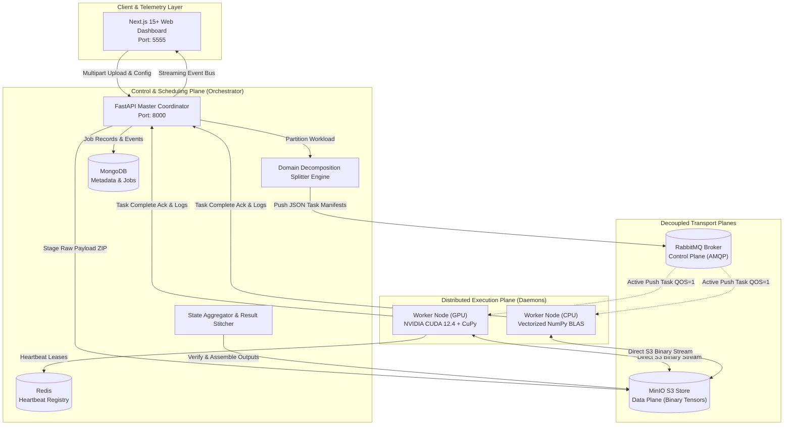

# DaeMon Codebase: Architectural Blueprint (`ARCHITECTURE.md`)

> **Generated by:** `/gsd-map-codebase`  
> **Repository:** `Gaurravvvv/Daemon`  
> **Scope:** High-level system architecture, design patterns, separation of concerns, and resilience mechanics.  

---

## 1. High-Level Architectural Model

DaeMon implements a **decoupled, containerized, hub-and-spoke distributed compute architecture** designed specifically for volatile commodity edge networks.



---

## 2. Core Architectural Design Patterns

### A. Decoupled Control & Data Planes
- **Problem Solved:** Message brokers choke and crash when handling high-resolution images or multi-gigabyte scientific tensors.
- **Implementation:** RabbitMQ channels only carry metadata manifests (~1.2 KB JSON). Binary assets are staged in MinIO S3. Workers stream directly via HTTP/2, keeping broker RAM under 50 MB regardless of dataset volume.

### B. Active-Push vs. Passive-Pull Scheduling
- **Problem Solved:** Traditional volunteer grids (e.g. BOINC) use client-side polling with delays measured in minutes or hours.
- **Implementation:** Persistent AMQP connections with `prefetch_count=1`. As soon as a job is partitioned, tasks are actively pushed directly into worker queues, achieving **sub-second task dispatch**.

### C. Polymorphic Execution Engine (Strategy Pattern)
- **Problem Solved:** Heterogeneous workload types require completely different execution runtimes.
- **Implementation:** The worker implements a Strategy pattern:
  - `ImageProcessingStrategy`: 2D spatial Sobel convolution and contrast enhancement via CuPy/NumPy.
  - `MatrixMultiplicationStrategy`: Block matrix sub-block multiplication via NumPy BLAS.
  - `CryptoSearchStrategy`: SHA-256 pre-image discovery and proof-of-work nonce mining.

### D. Hermetic Sandboxing & Hardware Tiering
- **Problem Solved:** Executing untrusted volunteer tasks can compromise host filesystems or freeze the machine.
- **Implementation:** Docker containers governed by Linux `cgroups v2` caps CPU and memory. NVIDIA Container Toolkit passes the GPU (`--gpus all`). Automatic smoke-testing dynamically demotes failing GPU nodes to CPU mode.

---

## 3. Resilience & Churn Fault Tolerance

```
[Worker Active] ──(Heartbeat every 5s)──► [Redis TTL Lease = 15s]
       │
       ▼ (Node crashes / Lid closes)
[No Heartbeat]
       │
       ▼ (15 seconds elapse)
[TTL <= 0: Key Expires]
       │
       ▼
[Reaper Loop Detects Expiry] ──► Mark Worker OFFLINE in Mongo
                                ──► Find In-Progress Tasks
                                ──► Re-Publish Manifest to RabbitMQ
                                ──► Healthy Worker Claims & Finishes
```

- **Lease Duration:** 15 seconds.
- **Heartbeat Interval:** 5 seconds.
- **Eviction & Recovery Latency:** $\le 15.2$ seconds with zero data loss.
- **Retry Ceiling:** Tasks enforce $R_{\text{max}} = 3$ retries before flagging critical failure.
