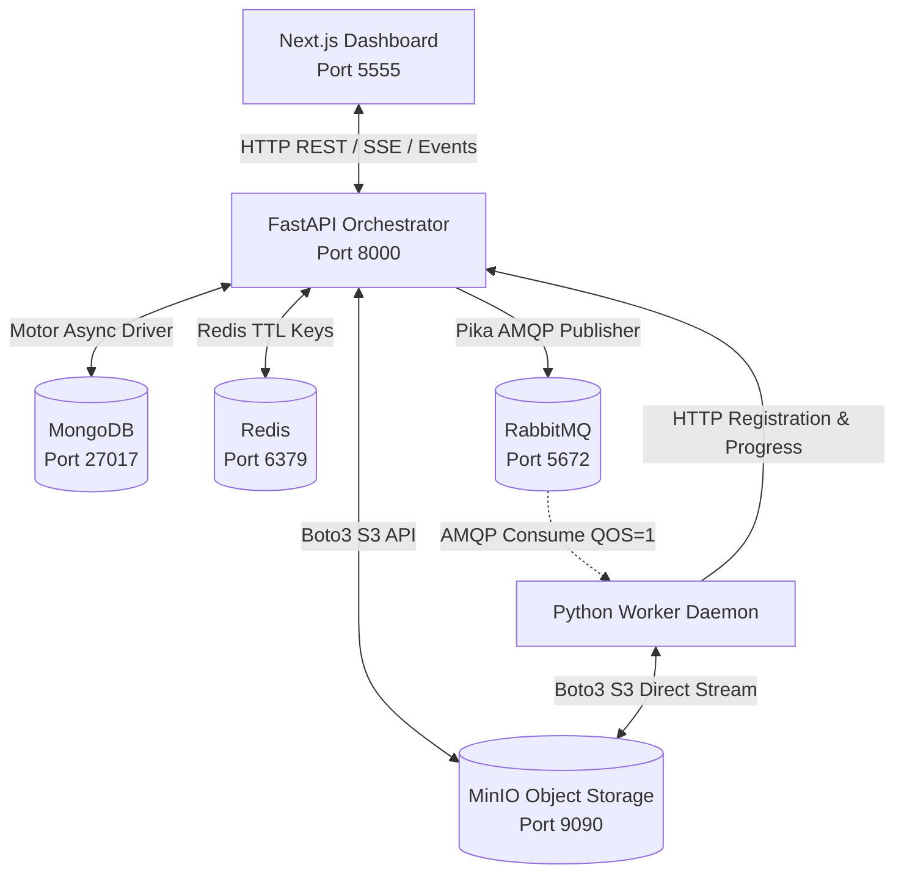

# DaeMon Codebase: Integrations & Network Protocols (`INTEGRATIONS.md`)

> **Generated by:** `/gsd-map-codebase`  
> **Repository:** `Gaurravvvv/Daemon`  
> **Scope:** Inter-service protocols, data paths, message contracts, and third-party integrations.  

---

## 1. Subsystem Integration Topology

---

## 2. Integration Protocols & Data Paths

### A. Client ➔ Master Orchestrator (Next.js ➔ FastAPI)
- **Transport:** HTTP/1.1 (JSON & Multipart Form-Data).
- **Core Endpoints:**
  - `POST /api/v1/jobs/upload_and_submit`: Multipart form file upload (`payload.zip`, `job_name`, `job_type`, `pool_id`, `compute_mode`, `password`).
  - `GET /api/v1/jobs`: Polls active and completed job records.
  - `GET /api/v1/jobs/{job_id}/events?after=<timestamp>`: Streams granular event logs.
  - `POST /api/v1/jobs/{job_id}/verify_password`: Authenticates access for private pool tasks.
  - `GET /api/v1/jobs/{job_id}/download`: Streams assembled result ZIP file directly from memory.

### B. Master Orchestrator ➔ Message Broker (FastAPI ➔ RabbitMQ)
- **Transport:** AMQP 0-9-1 via `pika.BlockingConnection`.
- **Topologies & Queues:**
  - Queues are partitioned dynamically per `pool_id` (e.g., `public_pool`, `private_cluster_01`).
  - Durable queues with message persistence (`delivery_mode=2`).
  - **Decoupled Architecture:** Messages contain strictly micro-task control manifests (~1.2 KB), never binary data.

### C. Message Broker ➔ Worker Daemon (RabbitMQ ➔ Worker)
- **Transport:** AMQP consumer loop via `pika`.
- **QoS & Concurrency:**
  - `basic_qos(prefetch_count=1)`: Enforces fair dispatch—a worker holds at most 1 task simultaneously.
  - Workers acknowledge messages (`basic_ack`) only upon successful completion and upload to MinIO.
  - If a worker lacks required hardware (e.g. CPU node receiving a `gpu_only` task), it invokes `basic_nack(requeue=True)` to release it back into the queue for a GPU worker.

### D. Out-of-Band Object Storage (Worker & Orchestrator ➔ MinIO)
- **Transport:** AWS S3 REST API (v4 Signature) via `boto3`.
- **Bucket:** `daemon-jobs`.
- **Object Key Conventions:**
  - Raw Upload: `{job_id}/{filename}` (e.g. `job-1042/payload.zip`).
  - Worker Results: `{job_id}/results/{task_id}_[edges|enhanced|matrix]_{name}`.
  - Master Stitched Deliverable: `{job_id}/results/{job_id}_results.zip`.
- **Performance Impact:** Eliminates broker network saturation; streams line-rate at 100+ MB/s.

### E. Metadata Persistence (Orchestrator ➔ MongoDB)
- **Driver:** `motor.motor_asyncio.AsyncIOMotorClient`.
- **Database:** `daemon_grid`.
- **Collections:**
  - `jobs`: Master job records (`job_id`, `job_name`, `job_type`, `status`, `pool_id`, `progress`, `total_chunks`, `completed_chunks`, `raw_data_url`).
  - `workers`: Registered worker nodes (`worker_id`, `pool_id`, `capabilities`, `system_info`, `status`).
  - `job_events`: High-frequency real-time execution logs (`job_id`, `timestamp`, `source`, `level`, `message`, `worker_id`).

### F. Heartbeat & Cache Registry (Worker & Orchestrator ➔ Redis)
- **Role:** Ephemeral sliding-window lease registry.
- **Key Pattern:** `worker:{worker_id}:lease` with 15-second TTL.
- **Failover:** Orchestrator scans TTL leases; expired keys trigger automated task recovery.
