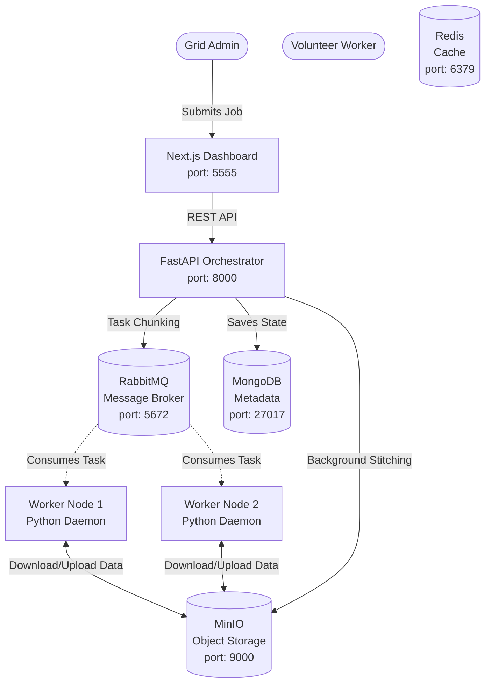

# DaeMon Compute Grid

A frictionless, containerized distributed computing grid that allows volunteers to donate idle compute power to process massive tasks (like AI Image Upscaling, Cryptography, and Complex Math).

## 🏗️ System Architecture



## 🚀 How to Run the Project Locally

### The 1-Click Startup (Recommended)
You can boot up the entire grid (Infrastructure + Backend + Frontend) instantly using the batch file at the root of the project:
```bash
# Just double click this file in Windows File Explorer!
start_grid.bat
```
*Note: This script launches the UI on **Port 5555** to bypass a common Windows Hyper-V bug that blocks Node from using Port 3000. It will automatically open Google Chrome for you.*

---

### Manual Startup (Advanced)
If you prefer to start services individually, follow these steps:

**1. Boot up the Infrastructure**
You need Docker Desktop installed. This command spins up RabbitMQ, Redis, MongoDB, and MinIO locally.
```bash
docker-compose up -d
```
*Note: The MinIO volume maps directly to your `D:\` drive.*

**2. Start the FastAPI Orchestrator**
The backend brain that manages jobs and queues tasks.
```bash
cd orchestrator
python -m venv venv
.\venv\Scripts\Activate.ps1
pip install -r requirements.txt
uvicorn main:app --reload --port 8000
```

**3. Start the Next.js Dashboard**
The multi-role UI for monitoring the grid. **(Note: You must `cd` into the dashboard folder to run this!)**
```bash
cd dashboard
npm install
npm run dev -- -p 5555
```
Once started, visit `http://localhost:5555` in your browser. You will be greeted by the **Role Gateway**, where you can log in as either the **Orchestrator** (admin/admin) or a **Worker Node**.

### 4. Start a Worker Daemon (Volunteer Node)
To simulate a volunteer joining the grid, open a new terminal and run the worker script:
```bash
cd worker
python -m venv venv
.\venv\Scripts\Activate.ps1
pip install -r requirements.txt
python main.py
```

## 📁 Repository Structure
- `/orchestrator` - FastAPI backend. Includes the Task Splitter and State Aggregator.
- `/worker` - The Python Daemon. Connects to RabbitMQ, downloads chunks from MinIO, and executes `strategies/`.
- `/dashboard` - Next.js React frontend with a custom dark-mode terminal aesthetic.
- `/MD` - Brainstorming and architecture planning documents.
